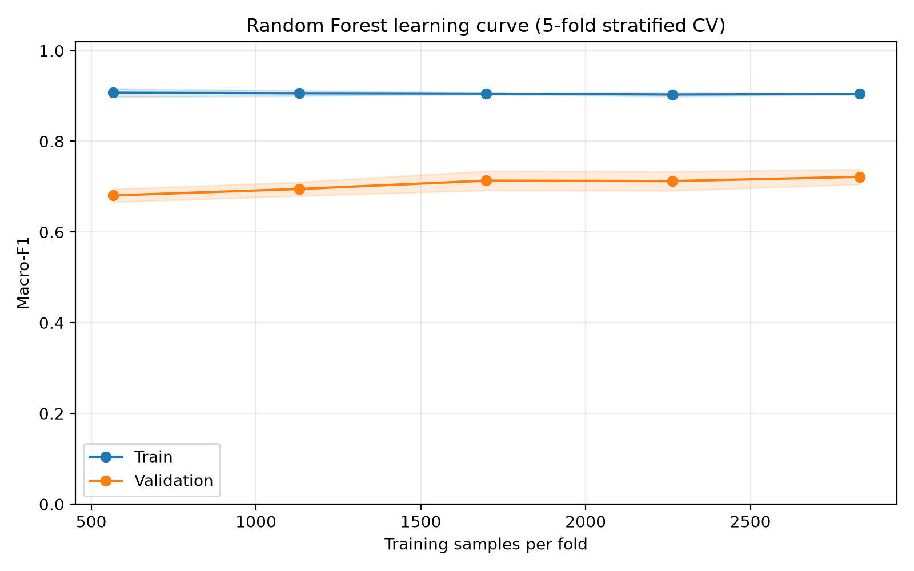

# Random Forest và đánh giá chung

## Phương pháp

Random Forest dùng tập C với 3.539 dòng train. Pipeline gồm feature engineering và tiền xử lý trong từng fold, không chuẩn hóa đầu vào. RandomizedSearchCV thử 20 cấu hình trên Stratified 5-fold, seed 42, chọn theo Macro-F1. Sau khi chọn, pipeline được fit lại trên toàn bộ train và lưu ở `models/rf_best.joblib`.

Tham số cuối: 100 cây, `max_features=sqrt`, `min_samples_split=10`, `min_samples_leaf=2`, `class_weight=balanced`, `max_depth=None`.

## Kết quả CV

| Độ đo | Trung bình | Độ lệch chuẩn |
|---|---:|---:|
| Macro-F1 | 0,7256 | 0,0143 |
| Balanced accuracy | 0,7311 | 0,0158 |
| Accuracy | 0,7666 | 0,0120 |
| Recall Dropout | 0,7308 | 0,0205 |
| F1 Enrolled | 0,5439 | 0,0248 |

Macro-F1 train qua fold đạt khoảng 0,9062; khoảng cách với validation cho thấy dấu hiệu overfit. Learning curve tăng khi thêm dữ liệu nhưng khoảng cách train-validation vẫn đáng kể.

## Kết quả cuối

Cấu hình đã khóa được đánh giá một lần trên hold-out 885 mẫu. RF đạt Macro-F1 0,7057, balanced accuracy 0,7148, accuracy 0,7469, Recall Dropout 0,7113 và F1 Enrolled 0,5144. Confusion matrix theo thứ tự Dropout, Enrolled, Graduate:

| Nhãn thật / Dự đoán | Dropout | Enrolled | Graduate |
|---|---:|---:|---:|
| Dropout | 202 | 57 | 25 |
| Enrolled | 30 | 98 | 31 |
| Graduate | 14 | 67 | 361 |

RF có Macro-F1 hold-out cao nhất theo trị số, nhưng SVM chỉ thấp hơn 0,00016. Không thể kết luận RF vượt trội có ý nghĩa. SVM nhận diện Enrolled tốt hơn; GB có Recall Dropout cao hơn. Enrolled vẫn là lớp khó nhất.

## Tái lập và tệp liên quan

- `notebooks/Experiments/Logs/Experiment_06_Random_Forest/rf_search_results.csv`, `reports/rf_cv_metrics.csv`, `notebooks/Experiments/Logs/Experiment_06_Random_Forest/rf_learning_curve.csv`
- `reports/evaluation/holdout/RF_predictions.csv`, `RF_confusion.csv`, `RF_classification.txt`
- [Bảng so sánh năm mô hình](../../../../docs/evaluation/holdout_summary.md)
- Chạy kiểm thử: `python -m unittest discover -s tests -v`
- Không chạy lại đánh giá hold-out. Dùng artifacts và kết quả đã lưu.
