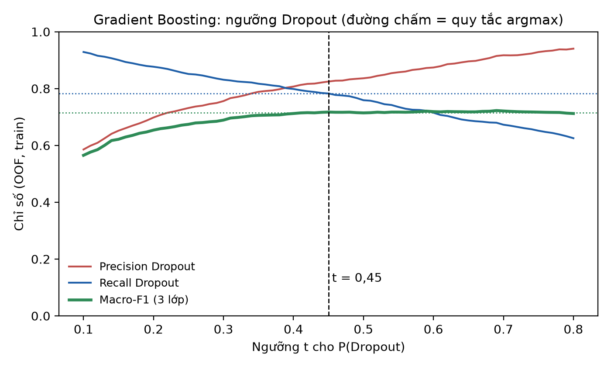
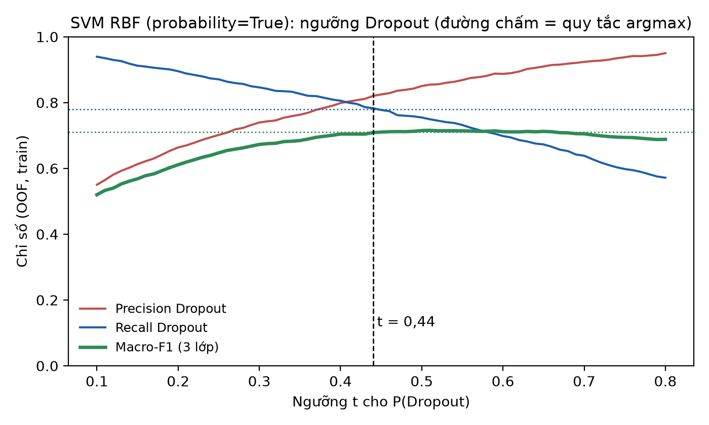

#  - Ngưỡng Dropout, xác suất, cân bằng lớp và dựng lại mô hình (issue #34)

Tác giả: Hoàng Đăng Hậu (). Mọi số liệu là **CV 5 fold trên tập train** (feature set C, seed 42,
`src.evaluate.get_cv`); tập test không được đọc hay chấm. Chạy trong môi trường chung (Python 3.12.10, scikit-learn 1.9.1, numpy 2.5.4, pandas 3.1.1, imbalanced-learn 0.14.2). Lệnh tái lập ở cuối tệp.

## 1. Xác suất (Probability experiment)
- **Gradient Boosting** có `predict_proba` sẵn. Xác suất OOF khá hiệu chỉnh: log-loss 0,547; Brier(Dropout) 0,091; ECE(Dropout) 0,018.
- **SVM** hiện dùng `SVC` mặc định (`probability=False`) nên **không có `predict_proba`**. Để dùng ngưỡng phải bật `probability=True` (`models/svm_best_proba.joblib`, `src/models/proba.py`). Log-loss 0,552; ECE(Dropout) 0,013.
  Lưu ý: với `probability=True`, `predict()` và `argmax(predict_proba)` **lệch nhau ở 12,3% dòng** (Platt scaling nội bộ không dùng `class_weight`), và Macro-F1 theo argmax xác suất (0,710) thấp hơn `predict()` của SVM gốc (0,721). Vì vậy khi dùng ngưỡng cho SVM phải dùng xác suất cho **cả** quyết định, không trộn với `predict()`. sklearn 1.9 cũng cảnh báo `SVC(probability=True)` bị khai tử ở bản 1.11 (thay bằng `CalibratedClassifierCV`).
- Thứ tự cột xác suất luôn là `classes_ = ['Dropout', 'Enrolled', 'Graduate']` (= `config.CLASSES`); `oof_proba` kiểm tra thứ tự này.

## 2. Quy tắc quyết định và tiêu chí chọn ngưỡng (Threshold experiment)
Quy tắc đa lớp (`src/threshold.py::apply_threshold`): nếu P(Dropout) ≥ t thì nhãn là Dropout; ngược lại là lớp lớn nhất trong {Enrolled, Graduate}. Quy tắc gốc là `argmax` thuần.

Tiêu chí đặt trước khi chọn: trong các ngưỡng 0,10 đến 0,80 (bước 0,01) có **Recall Dropout ≥ Recall Dropout của argmax**, chọn ngưỡng có **Macro-F1 OOF cao nhất**; hòa thì chọn ngưỡng lớn hơn. Chọn ngưỡng chỉ dùng dự đoán OOF của train.

## 3. Kết quả ngưỡng (OOF 3.539 dòng train, trong đó 1,137 Dropout; xem bảng đầy đủ ở `notebooks/Experiments/Logs/Experiment_09_Threshold/threshold_table_{gb,svm}.csv`)

| Mô hình | Quy tắc | Macro-F1 | Precision Dropout | Recall Dropout | F1 Enrolled |
|---|---|---:|---:|---:|---:|
| GB | argmax (gốc) | 0,7145 | 0,816 | 0,783 | 0,484 |
| GB | **t = 0,45 (theo tiêu chí)** | 0,7173 | 0,825 | 0,783 | 0,489 |
| GB | t = 0,30 (ưu tiên phát hiện) | 0,6891 | 0,756 | 0,831 | 0,417 |
| GB | t = 0,25 | 0,6742 | 0,732 | 0,851 | 0,378 |
| SVM (proba) | argmax (gốc) | 0,7098 | 0,812 | 0,780 | 0,476 |
| SVM (proba) | **t = 0,44 (theo tiêu chí)** | 0,7089 | 0,820 | 0,783 | 0,467 |
| SVM (proba) | t = 0,30 | 0,6728 | 0,739 | 0,846 | 0,374 |

 

**Kiểm tra chọn ngưỡng có ăn may không (nested, chọn trên 4 fold, chấm trên fold còn lại):**
GB: Macro-F1 0,7139 ± 0,0108 so với argmax 0,7139 (bằng nhau), ngưỡng thắng argmax ở 1/5 fold; SVM: 0,7072 so với 0,7093, 2/5 fold. Ngưỡng chọn ổn định (GB: 0,41 đến 0,45; SVM: 0,44 đến 0,45).

## 4. Kết luận về ngưỡng
1. **Chỉnh ngưỡng không cải thiện Macro-F1** so với argmax: chênh +0,0028 (GB) và −0,0010 (SVM), nhỏ hơn nhiều so với độ lệch chuẩn giữa các fold (≈ 0,01), và nested không thắng. Macro-F1 gần như phẳng khi t từ 0,45 đến 0,70 (dao động trong khoảng 0,008 với GB và 0,010 với SVM).
2. Ngưỡng chỉ thật sự đổi **đánh đổi precision/recall Dropout**: hạ t xuống 0,30 nâng Recall Dropout của GB từ 0,78 lên 0,83 nhưng làm Precision Dropout giảm 0,816 → 0,756 và Macro-F1 giảm 2,5 điểm (F1 Enrolled giảm vì mẫu Enrolled bị gán sang Dropout). Nếu nhóm ưu tiên không bỏ sót sinh viên bỏ học, đây là lựa chọn có chủ đích, phải nêu rõ đánh đổi.
3. Đề xuất bàn giao: dùng **GB với t = 0,45** (kết quả của tiêu chí; thực tế gần như argmax). Nếu nhóm chọn ưu tiên phát hiện thì dùng t = 0,30 và ghi rõ trong báo cáo. Quyết định cuối thuộc Quốc (#18) và phải chốt trước khi chạy test.
4. Giới hạn: ngưỡng chọn trên OOF của cùng train dùng để tuning mô hình; không có tập validation độc lập thứ hai. SVM dùng Platt scaling nội bộ nên kém GB về tính nhất quán `predict`/`predict_proba`.

## 5. Cân bằng lớp (Imbalance comparison), `notebooks/Experiments/Logs/Experiment_05_Imbalance/imbalance_comparison_full.csv`
CV 5 fold trên train, mean ± std. Ba giá trị trong ô là Precision / Recall / F1. SMOTE là của `imbalanced-learn` (cột `smote_impl` = imblearn), nằm trong pipeline.

| Mô hình | Chiến lược | Macro-F1 | Dropout (P / R / F1) | Enrolled (P / R / F1) |
|---|---|---:|---|---|
| LogisticRegression | none | 0,698 ± 0,018 | 0,800 / 0,775 / 0,787 | 0,578 / 0,376 / 0,452 |
| LogisticRegression | class_weight | 0,711 ± 0,014 | 0,823 / 0,736 / 0,776 | 0,459 / 0,611 / 0,523 |
| LogisticRegression | SMOTE | 0,704 ± 0,011 | 0,811 / 0,749 / 0,778 | 0,461 / 0,545 / 0,497 |
| RandomForest | none | 0,678 ± 0,022 | 0,805 / 0,774 / 0,789 | 0,568 / 0,304 / 0,393 |
| RandomForest | class_weight | 0,725 ± 0,014 | 0,853 / 0,738 / 0,791 | 0,486 / 0,606 / 0,539 |
| RandomForest | SMOTE | 0,720 ± 0,014 | 0,841 / 0,747 / 0,791 | 0,517 / 0,510 / 0,513 |
| SVM (RBF, best) | none | 0,707 ± 0,016 | 0,836 / 0,760 / 0,796 | 0,592 / 0,392 / 0,470 |
| SVM (RBF, best) | class_weight | 0,721 ± 0,011 | 0,851 / 0,727 / 0,784 | 0,471 / 0,635 / 0,540 |
| SVM (RBF, best) | SMOTE | 0,715 ± 0,019 | 0,832 / 0,745 / 0,785 | 0,478 / 0,557 / 0,512 |
| GradientBoosting (best) | none | 0,714 ± 0,012 | 0,816 / 0,783 / 0,799 | 0,571 / 0,422 / 0,482 |
| GradientBoosting (best) | SMOTE | 0,725 ± 0,015 | 0,830 / 0,769 / 0,798 | 0,545 / 0,501 / 0,521 |

Nhận xét:
- Cân bằng lớp **tăng F1 và Recall của Enrolled** rõ nhất (RF 0,393 → 0,539; LR 0,452 → 0,523; SVM 0,470 → 0,540 với class_weight) và Macro-F1 (LR +1,3; RF +4,6; SVM +1,4 điểm), nhưng đổi lại **Precision Enrolled giảm** (RF 0,568 → 0,486) và **Recall Dropout giảm nhẹ** (RF 0,774 → 0,738).
- `class_weight` cao hơn SMOTE ở LR, RF và SVM (SVM 0,721 so với 0,715). GB không có `class_weight`; SMOTE nâng GB từ 0,714 lên 0,725 (+1,2 điểm, cỡ một độ lệch chuẩn nên chưa đủ kết luận chắc).
- SVM "none" dùng tham số đã tuning cùng `class_weight=balanced` nên so sánh ở SVM mang tính tham khảo.
- **Chống leakage:** SMOTE nằm trong pipeline; `tests/test_sv4.py::SmoteOnlyOnTrainFoldTests` ghi lại số mẫu bộ lấy mẫu nhìn thấy mỗi fold: đúng 5 lần, mỗi lần chỉ ≈ 80% dữ liệu (phần train của fold), validation giữ nguyên số dòng.
- **Sửa lỗi:** `build_smote_pipeline` ở `src/imbalance.py` không chạy được với imbalanced-learn 0.14 (Pipeline lồng bước tiền xử lý); đã trải phẳng các bước. Số SMOTE ngày 07/11 (`imbalance_comparison.csv`) có thể chạy bằng bản dự phòng `SimpleSMOTE`, nên lệch với bảng này.
- **Số liệu cũ lệch:** `notebooks/Experiments/Logs/Experiment_05_Imbalance/imbalance_comparison.csv` (07/11) ghi RF + class_weight Macro-F1 = 0,7165, còn lần chạy lại này ghi 0,7248 (môi trường chung hiện tại). Bảng này thay thế bảng cũ khi chốt.

## 6. Dựng lại GB/SVM (GB/SVM model build), `models/*.meta.json`, `reports/sv4_rebuild_cv.csv`
- Tham số hạng 1: GB {n_estimators 200, learning_rate 0,05, max_depth 4, subsample 0,85}; SVM {RBF, C 10, gamma 0,003, class_weight balanced}, có `StandardScaler` trong pipeline. Test `tests/test_sv4.py` đối chiếu hằng số này với `gb/svm_search_results.csv`.
- CV dựng lại trong môi trường chung: GB Macro-F1 0,7139 ± 0,0119, Recall Dropout 0,783, F1 Enrolled 0,482 (khớp GB-C của Triết 0,7139); SVM 0,7213 ± 0,0113, 0,727, 0,540. Train Macro-F1: GB 0,900 (overfit rõ), SVM 0,769. `sv4_week3.md` (GB 0,719, F1 Enrolled 0,493) ghi theo lần chạy trước và nên được cập nhật theo số này.
- Metadata cũ ghi scikit-learn 1.8.0 (Quốc nêu ở #12/#13: lệch môi trường chung 1.9.1). Các `.joblib` và `*.meta.json` đã được dựng lại trong `.venv` chung và ghi phiên bản trong `*.meta.json`.
- `notebooks/Experiments/Logs/Experiment_06_Random_Forest/rf_summary.json` ghi `data_sha256` là `edc197d1...`; cần đối chiếu với SHA-256 của `data.csv` tính trên máy từng người (`Get-FileHash`) để chắc mọi người dùng cùng bản dữ liệu.

## Lệnh tái lập (PowerShell, tại thư mục chứa README)
```powershell
$env:PYTHONUTF8 = "1"
.\.venv\Scripts\python.exe scripts/build_gb_svm_models.py       # ghi đè models/gb_best, svm_best; thêm svm_best_proba + meta
.\.venv\Scripts\python.exe scripts/select_dropout_thresholds.py            # OOF, bảng + đồ thị ngưỡng, models/threshold_config.json
.\.venv\Scripts\python.exe scripts/compare_imbalance_strategies.py   # notebooks/Experiments/Logs/Experiment_05_Imbalance/imbalance_comparison_full.csv
.\.venv\Scripts\python.exe -m unittest tests.test_sv4
```
