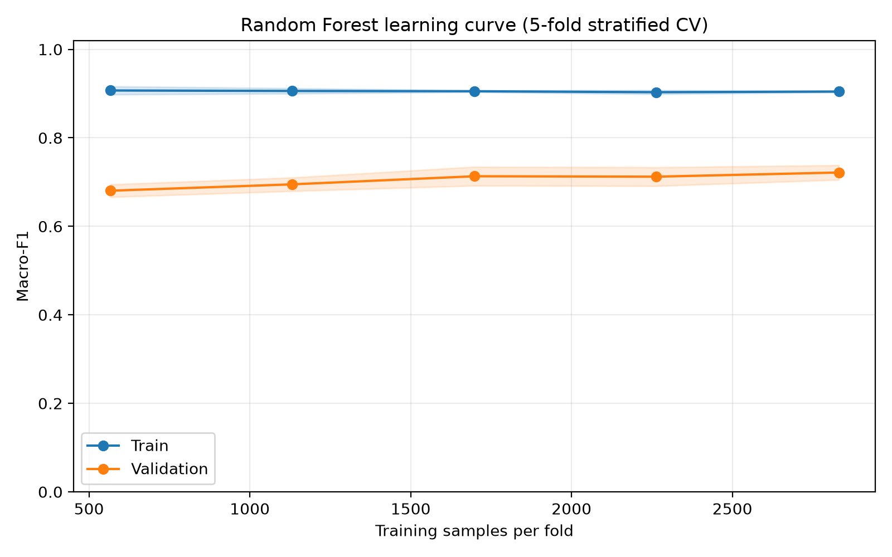

# Random Forest — Issue #10, SV1 Quốc

## Phương pháp

Tập đặc trưng C; 3539 mẫu train. Chia train/test phân tầng theo cấu hình chung, seed 42. Không đánh giá tập test; giữ cho issue #18.

RandomizedSearchCV 20 cấu hình trong không gian 648 tổ hợp, 5 fold, chọn theo Macro-F1. Tiền xử lý, One-Hot và các biến tạo thêm nằm trong Pipeline; không chuẩn hóa cho RF. Sau tuning, pipeline tốt nhất được fit lại trên toàn bộ train và lưu vào models/rf_best.joblib.

## Siêu tham số được chọn

```json
{
  "clf__n_estimators": 100,
  "clf__min_samples_split": 10,
  "clf__min_samples_leaf": 2,
  "clf__max_features": "sqrt",
  "clf__max_depth": null,
  "clf__class_weight": "balanced"
}
```

## Các độ đo chung trên CV train

| Độ đo | Trung bình | Độ lệch chuẩn |
|---|---:|---:|
| f1_macro | 0.7256 | 0.0143 |
| balanced_accuracy | 0.7311 | 0.0158 |
| accuracy | 0.7666 | 0.0120 |
| recall_dropout | 0.7308 | 0.0205 |
| f1_enrolled | 0.5439 | 0.0248 |

Macro-F1 train (CV): 0.9062.

Đây là CV sau lựa chọn siêu tham số trên cùng train/fold, có thể lạc quan; không phải đánh giá độc lập hoặc kết quả test.

## Learning curve



Đường bao là ±1 độ lệch chuẩn qua các fold; mỗi mức fit lại toàn bộ pipeline.

| Số mẫu train/fold | Macro-F1 train | Macro-F1 validation |
|---:|---:|---:|
| 566 | 0.9070 | 0.6804 |
| 1132 | 0.9059 | 0.6949 |
| 1698 | 0.9052 | 0.7132 |
| 2264 | 0.9031 | 0.7122 |
| 2831 | 0.9045 | 0.7216 |

Khoảng cách train–validation ở mức lớn nhất là 0.1829. Khoảng cách còn lớn, cho thấy dấu hiệu overfit.

Learning curve dùng mẫu đã xáo trộn và cùng kích thước train tuyệt đối cho mọi fold; điểm cuối có thể khác nhẹ CV tuning dùng trọn phần train mỗi fold.

## Tái lập

```powershell
.\.venv\Scripts\python.exe -X utf8 -m src.models.random_forest --feature-set C --n-iter 20 --n-jobs 4
.\.venv\Scripts\python.exe -X utf8 -m unittest discover -s tests -v
```

Phiên bản thư viện, SHA-256 dữ liệu, tham số và độ đo lưu trong rf_summary.json. requirements-rf.txt ghi chính xác các phiên bản dùng cho lượt chạy này. Chạy lệnh tại thư mục chứa README; cần dữ liệu gốc data/raw/data.csv.

Sản phẩm: rf_search_results.csv, rf_learning_curve.csv, rf_summary.json, rf_cv_metrics.csv, figures/rf_learning_curve.png và ../models/rf_best.joblib. Kết quả cũng được thêm vào cv_results.csv bằng hàm log chung (file Git ignore).
