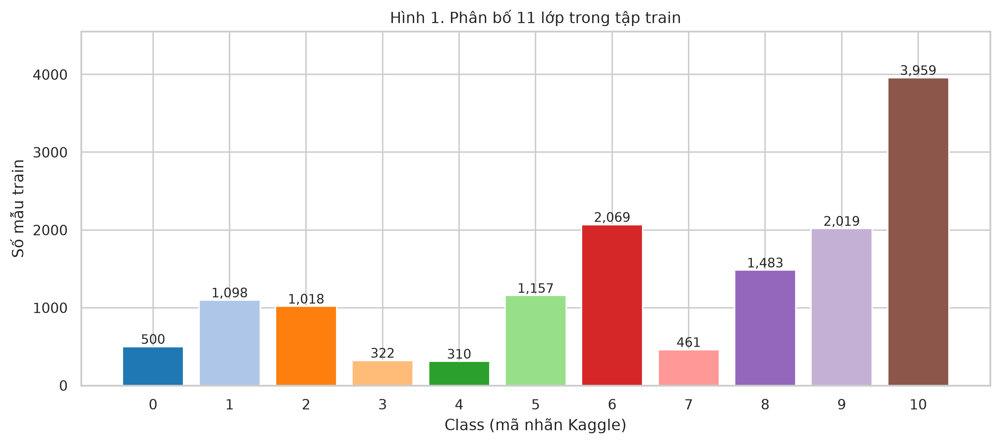
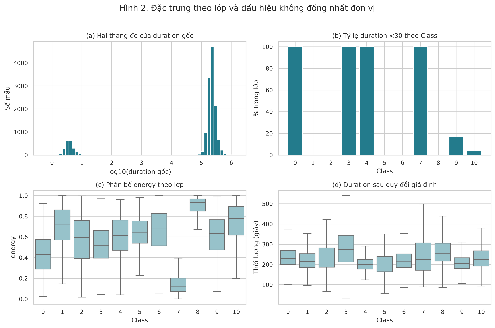

# 3. Dataset & Exploratory Data Analysis

**Phần B — Nguyễn Minh Triết, 3124411320.** Phân tích trên bộ dữ liệu Kaggle do người dùng cung cấp; không dùng dữ liệu bên ngoài. Số liệu do notebook `code/01_eda_B.ipynb` tính trực tiếp; ngày chạy, phiên bản thư viện và SHA-256 lưu ở mục 9 của notebook.

## 3.1. Nguồn và cấu trúc dữ liệu

Cuộc thi [Music Genre Classification](https://www.kaggle.com/competitions/shai-music-genre-classification/data) cung cấp dữ liệu dạng bảng, không có tín hiệu âm thanh. Train gồm **14.396 dòng × 18 cột**, test **3.600 dòng × 17 cột** và sample submission **3.600 dòng × 2 cột** (`Id`, `Class`). Sau khi bỏ Id và nhãn, có 16 đầu vào: hai chuỗi Artist Name, Track Name và 14 biến số/mã rời rạc (Popularity, danceability, energy, key, loudness, mode, speechiness, acousticness, instrumentalness, liveness, valence, tempo, duration_in min/ms, time_signature). Một dòng biểu diễn một bản ghi bài hát; cùng artist/track không bảo đảm cùng bản thu.

Nhãn Class có 11 mã 0–10. Chưa có ánh xạ thể loại được xác minh nên giữ nguyên mã thay vì tự đặt tên. ID duy nhất trong mỗi tập, không giao nhau giữa train và test; thứ tự ID sample submission khớp test. Train có 0 dòng trùng khi tính cả ID và 0 dòng trùng khi bỏ ID, 1081 dòng trùng phần đầu vào khi bỏ cả ID/nhãn. Test bỏ ID có 71 dòng trùng. ID chỉ phục vụ truy vết/xuất bài.

## 3.2. Phân bố lớp

Hình 1 cho thấy mất cân bằng: Class 10 có 3,959 mẫu (27.50%), Class 4 có 310 mẫu (2.15%), chênh 12.77 lần. Nhóm dùng phân tầng theo nhãn, seed 42 và 5 folds qua `common.py`. Accuracy là tiêu chí chính theo quy ước cuộc thi của nhóm; macro-F1 cần được báo bổ sung để theo dõi các lớp nhỏ. EDA này không chạy ablation class_weight và không tự khẳng định cân bằng lớp làm tốt/xấu hơn.

| Class | Số mẫu | Tỷ lệ |
|---|---:|---:|
| 0 | 500 | 3.47% |
| 1 | 1098 | 7.63% |
| 2 | 1018 | 7.07% |
| 3 | 322 | 2.24% |
| 4 | 310 | 2.15% |
| 5 | 1157 | 8.04% |
| 6 | 2069 | 14.37% |
| 7 | 461 | 3.20% |
| 8 | 1483 | 10.30% |
| 9 | 2019 | 14.02% |
| 10 | 3959 | 27.50% |

## 3.3. Thang đo duration và phân phối đặc trưng

Duration có hai cụm thang đo. Có 2075 dòng train (14.41%) dưới 30, nằm trong khoảng 0.502–29.886; phần còn lại bắt đầu từ 55775. Theo giả thuyết của A, nhóm nhỏ là phút và nhóm lớn là mili giây. B quy đổi giả định về giây để mô tả, đồng thời giữ cờ duration <30. Đây là diễn giải từ thang đo, chưa có metadata xác nhận đơn vị từng dòng. Ngưỡng <30 trong phân công và <1000 trong features.py khác nhau ở 0 dòng train / 0 dòng test; cần thống nhất trước khi C chốt pipeline. Bảng tỷ lệ theo từng lớp trong notebook kiểm chứng nhận xét các Class 0,3,4,7 có duration nhóm nhỏ.

Sự liên hệ mạnh giữa cờ đơn vị và Class có thể là dấu vết nguồn thu thập. C cần đánh giá ablation cờ này và nêu giới hạn khái quát hóa sang dữ liệu có đơn vị thống nhất. Hình 2 trình bày thang đo gốc, tỷ lệ cờ theo lớp, energy và duration sau quy đổi giả định.

Phân phối đầy đủ của 14 biến nằm ở mục 3 trong notebook. Loudness nằm trong [-39.952, 1.342], tempo [30.557, 217.416]. Các cực trị thống kê theo IQR không tự chứng minh lỗi dữ liệu; B không xóa hoặc winsorize. Các biến không âm lệch có thể được C thử log1p, trong khi key/mode/time_signature cần được xem như mã hoặc biến rời rạc phù hợp.

## 3.4. Dữ liệu thiếu

Các biến thiếu trong train gồm instrumentalness 24.60%, key 11.18%, Popularity 2.31%. Hình dữ liệu thiếu tại mục 4 trong notebook so sánh train/test và tỷ lệ thiếu theo Class; bảng trung vị nhóm thiếu/không thiếu Popularity trong notebook cho phép kiểm tra liệu nhóm thiếu có đặc điểm khác. Popularity thiếu ở 333 dòng; tỷ lệ thiếu là 12,0% ở Class 0 và 6,13% ở Class 4. Nhóm thiếu có trung vị acousticness 0,144 so với 0,0801 ở nhóm có giá trị, energy 0,654 so với 0,700. Các khác biệt không chứng minh cơ chế gây thiếu hoặc chứng minh giá trị 0 đã biến thành NaN.

Key quan sát có các giá trị [1.0, 2.0, 3.0, 4.0, 5.0, 6.0, 7.0, 8.0, 9.0, 10.0, 11.0]; số giá trị 0 trong train/test lần lượt 0/0. Thiếu giá trị 0 là dấu hiệu phù hợp với một giả thuyết về mã nốt C, nhưng không đủ xác định mọi NaN là nốt C. C nên giữ missing flags và so sánh imputation/giữ NaN trong folds, chưa tự gán tất cả NaN thành 0. Thống kê fit như median/scaler phải học trên train fold; các thống kê EDA toàn train chỉ phục vụ mô tả.

## 3.5. Tương quan và quan hệ nghệ sĩ/bài hát

Spearman energy–loudness = 0.735, energy–acousticness = -0.728, loudness–acousticness = -0.560 (pairwise non-missing). Ma trận bỏ Id/Class, duration quy đổi giả định. Tương quan giữa các đặc trưng cần được cân nhắc khi tạo tương tác và diễn giải importance; không mặc định loại biến chỉ vì có tương quan.

Train có 7913 nghệ sĩ duy nhất, 5289 chỉ có một dòng và 1375 xuất hiện ở nhiều Class. Có 2296/3.600 dòng test (63.78%) có nghệ sĩ xuất hiện trong train theo chuỗi nguyên gốc, trong khi tỷ lệ trên nghệ sĩ test duy nhất là 55.60%. Hai mẫu số này cần phân biệt. Kiểm chứng theo 5 folds chung: 58.68% mẫu validation biết nghệ sĩ từ train fold; quy tắc Class phổ biến của nghệ sĩ đúng 62.31% trên riêng nhóm đó. Khi thêm fallback lớp phổ biến train fold cho nghệ sĩ lạ, accuracy toàn bộ là 0.4487. Mốc A ghi 62,8% trên nhóm biết artist, chênh khoảng 0,49 điểm phần trăm so với B; cần đối chiếu quy tắc hòa/định nghĩa nhóm trước khi quy nguyên nhân. Đây là kiểm chứng mô tả của B, không phải mô hình cuối/tuning của D. Đặc trưng dùng nhãn nghệ sĩ cần cross-fit bên trong pipeline để tránh leakage; đánh giá nghệ sĩ mới cần cân nhắc split theo nhóm bổ sung.

Có 860 dòng test (23.89%) trùng tên Track Name và 607 dòng trùng cả Artist Name/Track Name với train. Trong train, 1336 tên bài và 1043 cặp artist/track có nhiều nhãn. Không suy ra nhãn test từ tên trùng; cover, bản thu khác và mâu thuẫn nhãn cần được xem riêng. Không có nhãn test để xác minh “trùng tên thì cùng thể loại”.

## 3.6. Chồng lấn trên PCA và bàn giao

PCA dùng 14 biến số với duration quy đổi, median imputation và chuẩn hóa fit chỉ trên train, không dùng nhãn trong bước chiếu. Hai thành phần giữ 33.12% phương sai (PC1 20.18%, PC2 12.94%). Cặp 8–10, 6–10, 1–10 có mức trộn láng giềng cao theo tiêu chí đối xứng 15-NN trong 2D; xem hình PCA tại mục 7 trong notebook. Chồng lấn phụ thuộc phép chiếu, mất cân bằng lớp và mã số rời rạc; chưa là confusion matrix hoặc bằng chứng về khả năng phân loại trong không gian đầy đủ.

Bàn giao `eda_findings.md` tổng hợp vấn đề đơn vị, thiếu, ngoại lệ, tương quan và nghệ sĩ cho C. Không thay đổi features.py hay sinh đặc trưng mô hình chính thức trong phần B. Cần C xác nhận nhận bản bàn giao; chưa có xác nhận trong lần chạy này. Các hình bổ sung và toàn bộ bảng nằm trong notebook; SHA-256 bảo đảm truy vết đúng dữ liệu gốc.
