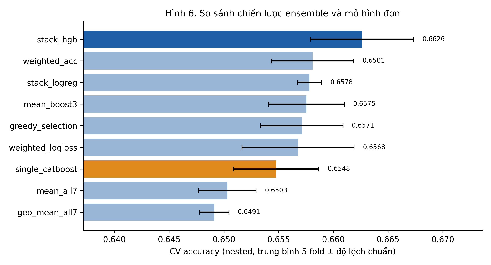
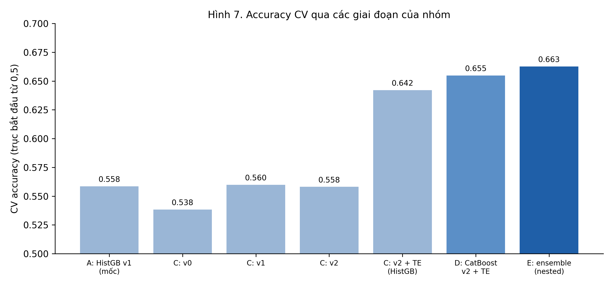
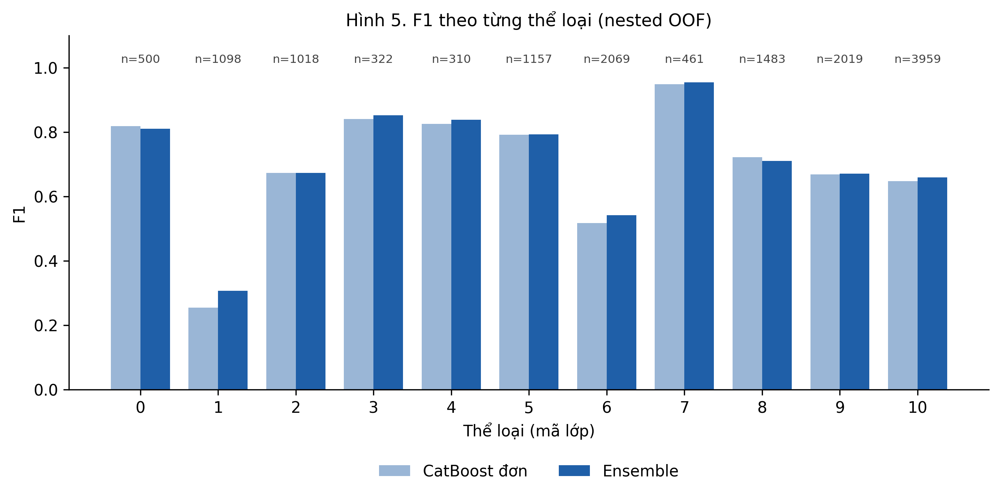
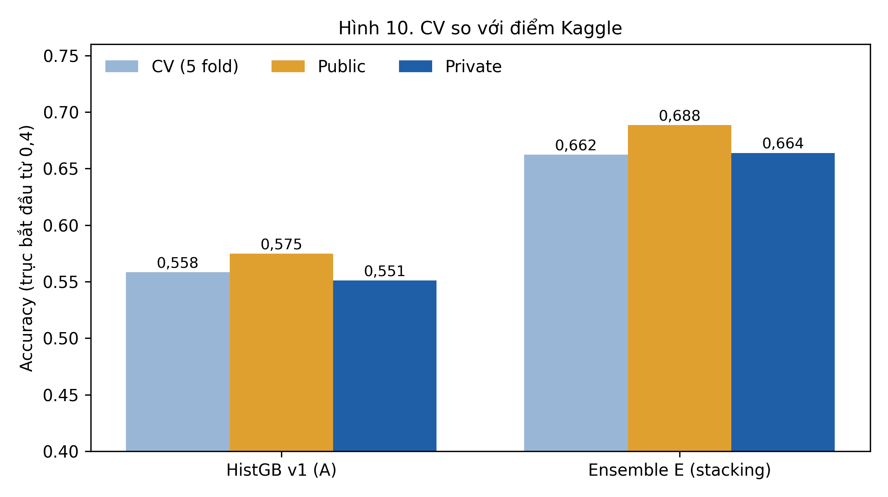

# 6. Results & Discussion

**Phần E — Hoàng Đăng Hậu, MSSV 3124411085.** Mọi số liệu trong mục này do `code/04_ensemble_results_E.py` (notebook `code/04_ensemble_results_E.ipynb`) tính trực tiếp từ các tệp xác suất OOF/test do D bàn giao (`evidence/cv_logs/`) cùng nhãn và fold của D (`evidence/models_D/`); bảng gốc nằm trong `evidence/ensemble_E/`. Các mục 6.1 đến 6.6 báo cáo điểm **cross-validation**; điểm leaderboard của bài nộp nằm ở mục 6.7.

## 6.1. Thiết lập đánh giá ensemble

E kết hợp bảy họ mô hình đã tuning của D (CatBoost, LightGBM, XGBoost, HistGB, MLP, SVM, ExtraTrees; tất cả dùng đặc trưng v2 + Artist Target Encoding). Trước khi ensemble, E kiểm tra khớp dữ liệu: fold của D trùng `common.get_folds` (StratifiedKFold, 5 fold, seed 42), mỗi tệp OOF có dạng (14.396 × 11), xác suất mỗi hàng cộng bằng 1, và điểm tính lại từ OOF trùng điểm trong `*_cv.json` của D đến 9 chữ số thập phân.

Tám chiến lược được so sánh: trung bình đều 7 mô hình; trung bình đều 3 mô hình boosting; trung bình hình học; trọng số tối ưu theo log-loss (SLSQP, không âm, tổng 1); trọng số tối ưu trực tiếp theo accuracy (tìm kiếm ngẫu nhiên và leo đồi); chọn mô hình tham lam có lặp [16]; stacking bằng hồi quy logistic và stacking bằng HistGradientBoosting nông, cả hai học trên log-xác suất (77 đặc trưng) [17].

**Cách tránh tự đánh giá quá lạc quan.** Với chiến lược có tham số học được, trọng số hoặc meta-learner chỉ được học trên 4 fold OOF rồi chấm trên fold còn lại, lần lượt cho cả 5 fold (*nested leave-one-fold-out*). Điểm báo cáo là điểm nested này. Điểm "in-sample" (học và chấm trên cùng OOF) chỉ dùng để đo độ lạc quan. Quy tắc chốt đặt trước: chọn ensemble có nested accuracy cao nhất; không dùng điểm public để chọn.

## 6.2. Kết quả chính

Bảng 3 (sinh tự động bởi script, trùng `paper/table_03_cv_results_E.md`).

| Mô hình / chiến lược | CV accuracy | Std | Macro F1 | Log-loss |
|---|---:|---:|---:|---:|
| CatBoost (đơn) | 0.6548 | 0.0039 | 0.7007 | 0.8993 |
| LightGBM (đơn) | 0.6540 | 0.0072 | 0.7066 | 0.8994 |
| XGBoost (đơn) | 0.6511 | 0.0037 | 0.7028 | 0.9061 |
| HistGB (đơn) | 0.6415 | 0.0043 | 0.6925 | 0.9343 |
| MLP (đơn) | 0.6315 | 0.0058 | 0.6716 | 0.9472 |
| SVM (đơn) | 0.6291 | 0.0049 | 0.6660 | 0.9759 |
| ExtraTrees (đơn) | 0.6164 | 0.0050 | 0.6571 | 1.0439 |
| **Ensemble: stacking HistGradientBoosting nông** | **0.6626** | 0.0047 | 0.7100 | 0.8891 |
| Ensemble: trọng số tối ưu accuracy (leo đồi) | 0.6581 | 0.0038 | 0.7070 | 0.8899 |
| Ensemble: stacking hồi quy logistic | 0.6578 | 0.0011 | 0.7085 | 0.8882 |
| Ensemble: trung bình đều 3 boosting | 0.6575 | 0.0035 | 0.7083 | 0.8911 |
| Ensemble: chọn tham lam có lặp | 0.6571 | 0.0038 | 0.7062 | 0.8903 |
| Ensemble: trọng số tối ưu log-loss | 0.6568 | 0.0051 | 0.7065 | 0.8862 |
| Ensemble: trung bình đều 7 mô hình | 0.6503 | 0.0026 | 0.6983 | 0.9044 |
| Ensemble: trung bình hình học 7 mô hình | 0.6491 | 0.0013 | 0.6960 | 0.8926 |

*Chú thích: accuracy là trung bình 5 fold; Std là độ lệch chuẩn giữa 5 fold (không phải khoảng tin cậy). Điểm ensemble là nested. Mốc baseline của A (HistGB v1) là 0,5585.*

Ensemble được chốt là **stacking HistGradientBoosting**, nested accuracy **0,6626 ± 0,0047**, macro F1 0,7100. So với mô hình đơn tốt nhất của D (CatBoost, 0,6548), mức tăng là **+0,78 điểm phần trăm** (tính trên toàn bộ 14.396 OOF: 0,6626 so với 0,6548). So với mốc 0,5585 của A, tổng mức tăng là +10,41 điểm phần trăm; phần lớn đến từ đặc trưng nghệ sĩ và mô hình boosting (mục 4, 5), không phải từ ensemble. Hình 7 tóm tắt tiến trình này.

**Mức tăng có đáng tin không?** Cải thiện +0,78 điểm phần trăm có khoảng tin cậy bootstrap 95% theo dòng là [+0,33; +1,24]; kiểm định McNemar: 611 dòng chỉ ensemble đúng so với 498 dòng chỉ CatBoost đúng (p = 0,0008); ensemble tốt hơn ở cả 5 fold (chênh +0,49 đến +1,25 điểm phần trăm). So với các ensemble đơn giản hơn, stacking HistGB hơn trung bình đều 3 boosting +0,51 điểm (CI [+0,06; +0,97]; 5/5 fold), hơn trọng số tối ưu accuracy +0,45 điểm (CI [0,00; +0,90], chạm 0; 5/5 fold) và hơn stacking logistic +0,48 điểm (CI [+0,04; +0,94]; chỉ 4/5 fold). Cần đọc kỹ ba hạn chế: (i) các dòng cùng nghệ sĩ không độc lập nên khoảng tin cậy theo dòng có thể quá hẹp; (ii) chúng tôi chọn 1 trong 8 chiến lược theo cùng nested accuracy nên điểm của chiến lược thắng có thể còn lạc quan nhẹ; (iii) CatBoost cũng đã được D chọn trên cùng các fold. Kết luận thận trọng: **ensemble hơn mô hình đơn khoảng 0,3–0,8 điểm phần trăm**, nhỏ nhưng nhất quán giữa các fold; khoảng 0,3 điểm là mức của ensemble đơn giản (trung bình đều 3 boosting), phần còn lại phụ thuộc vào meta-learner.

**Ba quan sát về các chiến lược.**
1. *Trung bình đều không phải lúc nào cũng tốt.* Trung bình đều cả 7 mô hình (0,6503) thấp hơn CatBoost đơn (0,6548), trùng với cảnh báo trong phân công: ba mô hình yếu hơn (MLP, SVM, ExtraTrees) kéo điểm xuống khi có trọng số bằng nhau. Chỉ lấy 3 boosting thì tăng lên 0,6575.
2. *Độ lạc quan của điểm in-sample tăng theo độ linh hoạt của meta-learner.* Chênh lệch giữa điểm in-sample và nested là −0,05 điểm (trọng số log-loss), +0,15 (trọng số accuracy), +0,21 (chọn tham lam), +1,24 (stacking logistic) và **+4,14** (stacking HistGB: 0,7040 so với 0,6626). Nếu chỉ nhìn in-sample, stacking HistGB sẽ có vẻ vượt trội một cách giả tạo; đây là lý do phải đánh giá nested.
3. *Log-loss và accuracy không cùng thứ tự.* Trọng số tối ưu log-loss đạt log-loss thấp nhất (0,8862) nhưng accuracy 0,6568, thấp hơn stacking HistGB (0,6626). Với metric của cuộc thi là accuracy, nhóm chọn theo accuracy.

## 6.3. Phân tích lỗi theo thể loại

Phân tích dưới đây dùng nested OOF của ensemble chốt (Bảng 4, Hình 4, Hình 5).

| Class | Số mẫu | Precision | Recall | F1 | F1 của CatBoost đơn | Số lần được dự đoán |
|---:|---:|---:|---:|---:|---:|---:|
| 0 | 500 | 0.792 | 0.830 | 0.811 | 0.819 | 524 |
| 1 | 1.098 | 0.455 | 0.231 | 0.307 | 0.254 | 558 |
| 2 | 1.018 | 0.680 | 0.665 | 0.673 | 0.673 | 995 |
| 3 | 322 | 0.873 | 0.832 | 0.852 | 0.841 | 307 |
| 4 | 310 | 0.850 | 0.826 | 0.838 | 0.826 | 301 |
| 5 | 1.157 | 0.776 | 0.810 | 0.792 | 0.791 | 1.208 |
| 6 | 2.069 | 0.515 | 0.573 | 0.542 | 0.518 | 2.302 |
| 7 | 461 | 0.956 | 0.952 | 0.954 | 0.949 | 459 |
| 8 | 1.483 | 0.727 | 0.695 | 0.711 | 0.721 | 1.418 |
| 9 | 2.019 | 0.699 | 0.644 | 0.670 | 0.668 | 1.859 |
| 10 | 3.959 | 0.622 | 0.701 | 0.659 | 0.647 | 4.465 |

*Bảng 4. Precision, recall, F1 theo thể loại. Tổng: accuracy 0,6626; macro F1 0,7100; weighted F1 0,6570.*

**Lớp ít mẫu không bị bỏ qua.** Câu hỏi đặt ra trong phân công là các lớp nhỏ (3 và 4) có bị mô hình bỏ qua không. Kết quả cho thấy ngược lại: lớp 3 (322 mẫu) có F1 = 0,852 với recall 0,832; lớp 4 (310 mẫu) có F1 = 0,838 với recall 0,826. Hai lớp này nằm trong nhóm dễ nhận nhất, cùng với lớp 7 (F1 = 0,954). Lỗi chính của chúng là nhầm sang lớp 0: 11,5% mẫu lớp 3 và 11,6% mẫu lớp 4 bị dự đoán là lớp 0.

**Điểm yếu nằm ở các lớp lớn và gần nhau.** F1 thấp nhất ở lớp 1 (0,307; recall chỉ 0,231) và lớp 6 (0,542), rồi lớp 10 (0,659). Các cặp nhầm nhiều nhất (đúng → dự đoán) là: 6 → 10 (482 mẫu, 23,3% lớp 6), 10 → 6 (408, 10,3% lớp 10), 8 → 10 (388, 26,2% lớp 8), 1 → 10 (352, 32,1% lớp 1) và 1 → 6 (337, 30,7% lớp 1). Lớp 10 là lớp lớn nhất (27,5% dữ liệu) và đóng vai trò "lớp hút": được dự đoán cho 31,0% mẫu, nhiều hơn tỉ lệ thật; ngược lại lớp 1 chỉ được dự đoán cho 3,9% mẫu trong khi chiếm 7,6% dữ liệu. Vì metric là accuracy, mô hình có xu hướng gán nhãn của lớp lớn khi không chắc chắn, đúng như đã dự báo ở phần EDA.

**Một giả thuyết và kiểm chứng của nó.** Theo bảng theo lớp trong notebook EDA của B (mục 3), cờ thời lượng thuộc thang phút (duration < 30) có ở **100%** mẫu train của các lớp 0, 3, 4, 7, ở 0% mẫu của các lớp 1, 2, 5, 6, 8, và ở 16,8% (lớp 9) và 3,6% (lớp 10). Bốn lớp 0, 3, 4, 7 cũng là các lớp có F1 cao (0,811; 0,852; 0,838; 0,954), và phần lớn lỗi của chúng nằm ngay trong nhóm này (lớp 3 nhầm sang lớp 0 ở 11,5% mẫu, lớp 4 nhầm sang lớp 0 ở 11,6%, lớp 0 nhầm sang lớp 3 và 4 ở 4,6% và 4,4%). Điều này phù hợp với việc cờ đơn vị là một đặc trưng rất mạnh, trong đó mô hình dễ tách nhóm {0, 3, 4, 7} khỏi phần còn lại rồi chỉ còn phân biệt các lớp trong nhóm. Đây là một hiện tượng của nguồn dữ liệu chứ không phải đặc tính âm nhạc. Giả thuyết này được kiểm chứng ở mục 6.6: khi bỏ cột duration và huấn luyện lại, F1 của lớp 0 giảm từ 0,813 xuống 0,429 và F1 các lớp 3, 4, 7 giảm 11 đến 15 điểm, trong khi các lớp 1, 5, 8 giảm dưới 1 điểm.

**Ensemble cải thiện ở đâu.** So với CatBoost đơn, F1 tăng rõ nhất ở lớp 1 (+0,052) và lớp 6 (+0,025), tức đúng ở những lớp khó và hay bị nhầm; giảm nhẹ ở lớp 0 (−0,009) và lớp 8 (−0,011). Phần lớn mức tăng accuracy tổng thể đến từ các lớp lớn.

## 6.4. Mỗi mô hình nền đóng góp bao nhiêu

Để biết thành phần nào quan trọng, E bỏ lần lượt từng mô hình khỏi ensemble chốt và chạy lại đánh giá nested (Bảng 5).

| Bỏ mô hình | Nested accuracy | Thay đổi so với ensemble đầy đủ |
|---|---:|---:|
| ExtraTrees | 0.6553 | −0.0073 |
| CatBoost | 0.6580 | −0.0046 |
| LightGBM | 0.6609 | −0.0017 |
| SVM | 0.6619 | −0.0007 |
| MLP | 0.6622 | −0.0004 |
| XGBoost | 0.6639 | +0.0013 |
| HistGB | 0.6655 | +0.0029 |

*Bảng 5. Ensemble đầy đủ: 0,6626. Chênh lệch dưới khoảng 0,3 điểm phần trăm nằm trong mức dao động giữa các fold (std khoảng 0,5 điểm), nên chỉ nên đọc xu hướng.*

Kết quả đáng chú ý là **ExtraTrees**: là mô hình đơn yếu nhất (0,6164) nhưng loại nó làm điểm giảm nhiều nhất (−0,73 điểm). Lý do hợp lý là đa dạng: ExtraTrees và các mô hình không phải boosting bất đồng với nhau nhiều hơn so với các boosting (tỉ lệ bất đồng dự đoán 14–21% khi có mặt một trong ExtraTrees/SVM/MLP, so với 7,6–10,5% giữa ba mô hình boosting; thấp nhất là LightGBM–XGBoost 7,6%, cao nhất là HistGB–MLP 20,6%). Ngược lại bỏ HistGB (+0,29 điểm) hoặc XGBoost (+0,13) không làm giảm điểm, vì chúng cùng họ boosting và rất giống CatBoost, LightGBM; các chênh này nằm trong mức dao động nên không nên đọc là "bỏ đi thì tốt hơn". Trần lý thuyết cũng cho thấy còn dư địa: ít nhất một trong 7 mô hình dự đoán đúng cho 76,8% mẫu, so với 66,3% của ensemble.

## 6.5. Kiểm tra độ bền và hạn chế

*Phân phối xác suất test khác OOF.* Xác suất test mà D bàn giao là trung bình của 5 mô hình outer, trong khi mỗi dòng OOF chỉ do 1 mô hình dự đoán. Do trung bình làm mềm xác suất, độ tự tin trung bình (xác suất lớn nhất) trên test thấp hơn trên OOF khoảng 0,8 đến 2,2 điểm phần trăm tuỳ mô hình (ví dụ CatBoost 0,650 → 0,641; HistGB 0,683 → 0,661). Do meta-learner học trên OOF, E kiểm tra xem lệch này có làm đổi kết quả nhiều không: tỉ lệ bất đồng giữa các ensemble trên test (ví dụ stacking HistGB và trung bình 3 boosting: 9,8%) gần với trên OOF (10,6%). Không thấy dấu hiệu lệch mạnh, nhưng đây là điểm cần lưu ý.

*Các hạn chế khác.*
1. Điểm nested của ensemble học trên OOF mà mỗi OOF lại do mô hình nền được huấn luyện trên dữ liệu bao gồm cả fold dùng để chấm. Đây là cách stacking thường làm và rò rỉ thường nhỏ, nhưng với meta-learner linh hoạt (HistGB) có thể làm điểm hơi cao; muốn loại bỏ hẳn cần huấn luyện lại mô hình nền trong từng vòng, việc ngoài phạm vi phần E.
2. CV phân tầng cho phép một nghệ sĩ xuất hiện ở cả train và validation. Điều này phù hợp với test của cuộc thi (khoảng 63,8% dòng test có nghệ sĩ đã biết) nhưng không đo được khả năng tổng quát hóa sang nghệ sĩ mới [6, 7].
3. Tần suất không nhãn trên train + test là thiết lập transductive đã được nhóm cho phép (mục 4, 5).
4. Điểm của mô hình đơn tốt nhất và các ensemble được chọn trên cùng các fold, nên có thiên lệch lựa chọn nhẹ. Điểm leaderboard của bài nộp được báo cáo ở mục 6.7; E không dùng điểm đó để chọn lại mô hình.
5. Meta-learner HistGB không tái lập hoàn toàn giữa hai máy: chạy lại script trên máy của nhóm cho nested accuracy 0,6626 ± 0,0047 (báo cáo ở đây và là bài nộp), còn lần chạy đầu của E trên máy khác cho 0,6623 ± 0,0024, với 79/3.600 dự đoán test khác nhau. Các chiến lược còn lại cho kết quả giống hệt. Chênh 0,03 điểm là nhiễu của meta-learner, không đổi kết luận.

## 6.6. Cột nào quan trọng nhất (permutation importance và ablation)

**Cách đo.** E chạy lại cấu hình HistGradientBoosting + đặc trưng v2 + target encoding của D trên đúng 5 fold chung (accuracy 0,6415, khớp với `histgb_v2_te_selected_D_cv.json`), rồi đo trên **cột gốc** (một cột gốc có thể sinh nhiều đặc trưng, ví dụ duration → cờ đơn vị + giá trị ms). Hai phép đo bổ sung cho nhau:
- *Permutation*: xáo trộn một cột trên fold validation, không huấn luyện lại, 3 lần xáo mỗi fold; đo accuracy giảm bao nhiêu.
- *Ablation*: thay cột bằng hằng số ở cả train và validation rồi huấn luyện lại 5 fold; đo accuracy và F1 theo lớp.

**Kết quả (Hình 8).**
- `Artist Name` quan trọng nhất: xáo trộn làm accuracy giảm 25,8 điểm; bỏ hẳn (ablation) còn 0,5412, giảm 10,0 điểm, ở cả 5/5 fold. Bỏ cả Artist và Track còn 0,5375.
- `duration_in min/ms` đứng thứ hai: permutation giảm 12,5 điểm, ablation giảm 4,0 điểm (0,6012), 5/5 fold.
- Nhóm tiếp theo nhỏ hơn nhiều: acousticness (−4,1), instrumentalness (−4,0), energy (−3,7), Popularity (−3,0) theo permutation. Bỏ nhóm cột hay thiếu (Popularity, key, instrumentalness) giảm 2,3 điểm.
- `tempo`, `key`, `mode`, `time_signature`, `liveness`, `loudness` gần như không đóng góp (dưới 0,4 điểm theo permutation; bỏ đi đôi khi còn tăng nhẹ accuracy, trong sai số).

**Giải thích khác biệt giữa hai phép đo.** Permutation luôn lớn hơn ablation vì khi một cột bị xáo trộn, mô hình vẫn dựa vào nó nhưng nhận giá trị sai; còn khi bỏ cột và huấn luyện lại, các cột tương quan (ví dụ energy với loudness và acousticness) bù lại phần nào. Vì vậy ablation là thước đo gần với "mất bao nhiêu nếu không có cột này" hơn; thứ hạng của hai phép đo giống nhau ở nhóm đầu.

**Kiểm chứng giả thuyết ở mục 6.3 (Hình 9).** Trong dữ liệu train, cờ thang phút của duration là 100% ở các lớp 0, 3, 4, 7, 0% ở các lớp 1, 2, 5, 6, 8, 16,8% ở lớp 9 và 3,6% ở lớp 10. Khi bỏ cột duration, F1 giảm mạnh đúng ở các lớp này: lớp 0 giảm 38,4 điểm (0,813 → 0,429), lớp 4 giảm 14,6, lớp 7 giảm 12,3, lớp 3 giảm 11,1; trong khi các lớp 1, 5, 8 giảm dưới 1 điểm. Như vậy giả thuyết được ủng hộ: phần lớn giá trị của duration đến từ việc đơn vị lưu trữ tách được nhóm {0, 3, 4, 7}, một đặc điểm của dữ liệu chứ không phải đặc tính âm nhạc. Ngược lại, bỏ Artist Name làm giảm F1 ở mọi lớp (2,3 đến 19,2 điểm), mạnh nhất ở các lớp 1, 2, 4, 6.

**Hạn chế.** (1) Chỉ đo trên một mô hình (HistGB); thứ hạng có thể khác với CatBoost. (2) Artist Name mạnh một phần vì cùng nghệ sĩ xuất hiện ở train và validation (xem hạn chế 2 ở mục 6.5), nên kết quả này không nói được gì về nghệ sĩ mới. (3) Permutation dùng 3 lần xáo, độ lệch chuẩn khoảng 0,3 đến 0,8 điểm, nên không nên đọc thứ hạng giữa các cột có chênh lệch nhỏ hơn mức đó.

## 6.7. Điểm trên Kaggle

Sau khi nhóm hoàn tất,  nộp `submissions/ensemble_E.csv` lên Kaggle (ảnh chụp: `evidence/leaderboard/20261115_my_submissions.png`). Cả ba lần nộp của nhóm đều được Kaggle đánh dấu "after deadline" (nộp muộn), nên điểm dưới đây dùng để đối chiếu với CV chứ không phải thứ hạng chính thức.

| Bài nộp | CV (5 fold) | Public | Private |
|---|---|---|---|
| `histgb_v1.csv` (mô hình đơn của A) | 0,5582 | 0,5746 | 0,5509 |
| `ensemble_E.csv` (stacking HistGB, nested CV) | 0,6626 | 0,6885 | 0,6639 |

*Bảng 6. CV và điểm Kaggle. `probe_all10.csv` (dự đoán toàn lớp 10, dùng để thăm dò tỉ lệ lớp) đạt 0,2663 public và 0,2954 private nên không đưa vào bảng.*

Nhận xét:
- Điểm **private của ensemble (0,6639) rất gần nested CV (0,6626)**, chênh +0,13 điểm phần trăm; điểm **public cao hơn CV 2,6 điểm** (0,6885). Với mô hình đơn của A cũng thấy kiểu tương tự: public cao hơn CV 1,6 điểm còn private thấp hơn 0,7 điểm. Public và private chấm trên hai phần khác nhau của tập test (Kaggle không công bố tỉ lệ chia); nếu mỗi phần có khoảng 1.000 đến 2.000 dòng thì độ lệch chuẩn của accuracy ở mỗi phần khoảng 1,1 đến 1,5 điểm phần trăm, nên chênh 2,5 điểm giữa public và private của ensemble vì vậy chưa đủ để kết luận mô hình "thật sự" tốt hơn hay kém hơn CV. Cách đọc thận trọng hơn là CV (0,663) và điểm private (0,664) cùng cho một mức ước lượng khoảng 0,66.
- **Ensemble hơn mô hình đơn của A** ở cả hai tập: +11,4 điểm (public) và +11,3 điểm (private), cùng hướng với tiến trình CV ở Hình 7 (0,558 → 0,662).
- CV đã dự báo đúng thứ tự giữa hai bài nộp và đúng mức độ cải thiện, tuy chưa có đủ bài nộp để đánh giá CV chọn mô hình tốt đến đâu giữa các ensemble gần nhau (chênh dưới 1 điểm); E chỉ nộp một ensemble nên không có bằng chứng từ leaderboard về việc stacking HistGB hơn trung bình đều 3 mô hình boosting.

## 6.8. Kết luận phần E

Stacking HistGradientBoosting trên bảy mô hình của D đạt nested CV accuracy 0,6626 ± 0,0047, hơn mô hình đơn tốt nhất (CatBoost, 0,6548) khoảng +0,78 điểm phần trăm, nhất quán ở cả 5 fold. Ensemble đơn giản (trung bình đều 3 boosting) đã mang lại khoảng +0,28 điểm; trung bình đều cả 7 mô hình lại làm giảm điểm. Phần lớn sai sót tập trung ở các lớp lớn và gần nhau (1, 6, 8, 10), còn các lớp ít mẫu 3, 4 và 7 được nhận diện tốt. Về dữ liệu, Artist Name là cột quan trọng nhất (bỏ đi giảm 10,0 điểm accuracy) và duration đứng thứ hai nhờ cờ đơn vị phút/ms (mục 6.6). Bài nộp `submissions/ensemble_E.csv` (3.600 dòng) đạt 0,6885 public và 0,6639 private trên Kaggle, phù hợp với nested CV 0,6626 (mục 6.7).
