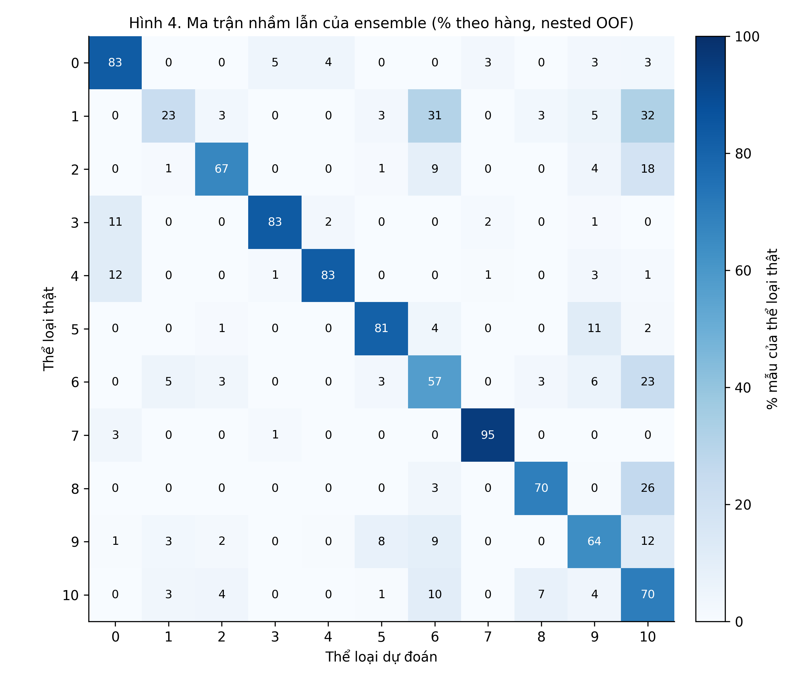

# 6. Results & Discussion

**Phần E — Hoàng Đăng Hậu, MSSV 3124411085.** Mọi số liệu trong mục này do `code/04_ensemble_results_E.py` (notebook `code/04_ensemble_results_E.ipynb`) tính trực tiếp từ các tệp xác suất OOF/test do D bàn giao (`evidence/cv_logs/`) cùng nhãn và fold của D (`evidence/models_D/`); bảng gốc nằm trong `evidence/ensemble_E/`. Đây là điểm **cross-validation**, không phải điểm leaderboard: chưa có lượt nộp Kaggle nào cho các mô hình của D và E.

## 6.1. Thiết lập đánh giá ensemble

E kết hợp bảy họ mô hình đã tuning của D (CatBoost, LightGBM, XGBoost, HistGB, MLP, SVM, ExtraTrees; tất cả dùng đặc trưng v2 + Artist Target Encoding). Trước khi ensemble, E kiểm tra khớp dữ liệu: fold của D trùng `common.get_folds` (StratifiedKFold, 5 fold, seed 42), mỗi tệp OOF có dạng (14.396 × 11), xác suất mỗi hàng cộng bằng 1, và điểm tính lại từ OOF trùng điểm trong `*_cv.json` của D đến 9 chữ số thập phân.

Tám chiến lược được so sánh: trung bình đều 7 mô hình; trung bình đều 3 mô hình boosting; trung bình hình học; trọng số tối ưu theo log-loss (SLSQP, không âm, tổng 1); trọng số tối ưu trực tiếp theo accuracy (tìm kiếm ngẫu nhiên và leo đồi); chọn mô hình tham lam có lặp [16]; stacking bằng hồi quy logistic và stacking bằng HistGradientBoosting nông, cả hai học trên log-xác suất (77 đặc trưng) [17].

**Cách tránh tự đánh giá quá lạc quan.** Với chiến lược có tham số học được, trọng số hoặc meta-learner chỉ được học trên 4 fold OOF rồi chấm trên fold còn lại, lần lượt cho cả 5 fold (*nested leave-one-fold-out*). Điểm báo cáo là điểm nested này. Điểm "in-sample" (học và chấm trên cùng OOF) chỉ dùng để đo độ lạc quan. Quy tắc chốt đặt trước: chọn ensemble có nested accuracy cao nhất; không dùng điểm public để chọn.

## 6.2. Kết quả chính

Bảng 3 (sinh tự động bởi script, trùng `paper/table_03_cv_results_E.md`).

| Mô hình / chiến lược | CV accuracy | Std | Macro F1 | Log-loss |
|---|---:|---:|---:|---:|
| CatBoost (đơn) | 0.6548 | 0.0039 | 0.7007 | 0.8993 |
| LightGBM (đơn) | 0.6540 | 0.0072 | 0.7066 | 0.8994 |
| XGBoost (đơn) | 0.6511 | 0.0037 | 0.7028 | 0.9061 |
| HistGB (đơn) | 0.6415 | 0.0043 | 0.6925 | 0.9343 |
| MLP (đơn) | 0.6315 | 0.0058 | 0.6716 | 0.9472 |
| SVM (đơn) | 0.6291 | 0.0049 | 0.6660 | 0.9759 |
| ExtraTrees (đơn) | 0.6164 | 0.0050 | 0.6571 | 1.0439 |
| **Ensemble: stacking HistGradientBoosting nông** | **0.6626** | 0.0047 | 0.7100 | 0.8891 |
| Ensemble: trọng số tối ưu accuracy (leo đồi) | 0.6581 | 0.0038 | 0.7070 | 0.8899 |
| Ensemble: stacking hồi quy logistic | 0.6578 | 0.0012 | 0.7081 | 0.8882 |
| Ensemble: trung bình đều 3 boosting | 0.6575 | 0.0035 | 0.7083 | 0.8911 |
| Ensemble: chọn tham lam có lặp | 0.6571 | 0.0038 | 0.7062 | 0.8903 |
| Ensemble: trọng số tối ưu log-loss | 0.6568 | 0.0051 | 0.7065 | 0.8862 |
| Ensemble: trung bình đều 7 mô hình | 0.6503 | 0.0026 | 0.6983 | 0.9044 |
| Ensemble: trung bình hình học 7 mô hình | 0.6491 | 0.0013 | 0.6960 | 0.8926 |

*Chú thích: accuracy là trung bình 5 fold; Std là độ lệch chuẩn giữa 5 fold (không phải khoảng tin cậy). Điểm ensemble là nested. Mốc baseline của A (HistGB v1) là 0,5585.*

Ensemble được chốt là **stacking HistGradientBoosting**, nested accuracy **0,6626 ± 0,0047**, macro F1 0,7100. So với mô hình đơn tốt nhất của D (CatBoost, 0,6548), mức tăng là **+0,78 điểm phần trăm** (0,6626 so với 0,6548 trên 14.396 dòng OOF). So với mốc 0,5585 của A, tổng mức tăng là +10,41 điểm phần trăm; phần lớn đến từ đặc trưng nghệ sĩ và mô hình boosting (mục 4, 5), không phải từ ensemble. Hình 7 tóm tắt tiến trình này.

**Mức tăng có đáng tin không?** Cải thiện +0,78 điểm phần trăm có khoảng tin cậy bootstrap 95% theo dòng là [+0,33; +1,24]; kiểm định McNemar: 611 dòng chỉ ensemble đúng so với 498 dòng chỉ CatBoost đúng (p = 0,00076). Ensemble tốt hơn ở cả 5 fold so với CatBoost, chênh +0,49 đến +1,25 điểm phần trăm. So với các ensemble đơn giản hơn, stacking HistGB hơn trung bình đều 3 boosting +0,51 điểm (CI [+0,06; +0,97], tốt hơn cả 5 fold), hơn stacking logistic +0,49 điểm (tốt hơn 4/5 fold), và hơn trọng số tối ưu accuracy +0,45 điểm (CI [0; +0,90], tốt hơn cả 5 fold). Cần đọc kỹ ba hạn chế: (i) các dòng cùng nghệ sĩ không độc lập nên khoảng tin cậy theo dòng có thể quá hẹp; (ii) chúng tôi chọn 1 trong 8 chiến lược theo cùng nested accuracy nên điểm của chiến lược thắng có thể còn lạc quan nhẹ; (iii) CatBoost cũng đã được D chọn trên cùng các fold. Kết luận thận trọng: mức tăng so với mô hình đơn dưới 1 điểm phần trăm và có thể còn lạc quan do lựa chọn mô hình.

**Ba quan sát về các chiến lược.**
1. *Trung bình đều không phải lúc nào cũng tốt.* Trung bình đều cả 7 mô hình (0,6503) thấp hơn CatBoost đơn (0,6548), trùng với cảnh báo trong phân công: ba mô hình yếu hơn (MLP, SVM, ExtraTrees) kéo điểm xuống khi có trọng số bằng nhau. Chỉ lấy 3 boosting thì tăng lên 0,6575.
2. *Độ lạc quan của điểm in-sample tăng theo độ linh hoạt của meta-learner.* Chênh lệch giữa điểm in-sample và nested là −0,05 điểm (trọng số log-loss), +0,15 (trọng số accuracy), +0,21 (chọn tham lam), +1,24 (stacking logistic) và **+4,14** (stacking HistGB: 0,7040 so với 0,6626). Nếu chỉ nhìn in-sample, stacking HistGB sẽ có vẻ vượt trội một cách giả tạo; đây là lý do phải đánh giá nested.
3. *Log-loss và accuracy không cùng thứ tự.* Trọng số tối ưu log-loss đạt log-loss thấp nhất (0,8862) nhưng accuracy 0,6568, thấp hơn stacking HistGB (0,6626). Với metric của cuộc thi là accuracy, nhóm chọn theo accuracy.

## 6.3. Phân tích lỗi theo thể loại

Phân tích dưới đây dùng nested OOF của ensemble chốt (Bảng 4, Hình 4, Hình 5).

| Class | Số mẫu | Precision | Recall | F1 | F1 của CatBoost đơn | Số lần được dự đoán |
|---:|---:|---:|---:|---:|---:|---:|
| 0 | 500 | 0.792 | 0.830 | 0.811 | 0.819 | 524 |
| 1 | 1.098 | 0.455 | 0.231 | 0.307 | 0.254 | 558 |
| 2 | 1.018 | 0.680 | 0.665 | 0.673 | 0.673 | 995 |
| 3 | 322 | 0.873 | 0.832 | 0.852 | 0.841 | 307 |
| 4 | 310 | 0.850 | 0.826 | 0.838 | 0.826 | 301 |
| 5 | 1.157 | 0.776 | 0.810 | 0.792 | 0.791 | 1.208 |
| 6 | 2.069 | 0.515 | 0.573 | 0.542 | 0.518 | 2.302 |
| 7 | 461 | 0.956 | 0.952 | 0.954 | 0.949 | 459 |
| 8 | 1.483 | 0.727 | 0.695 | 0.711 | 0.721 | 1.418 |
| 9 | 2.019 | 0.699 | 0.644 | 0.670 | 0.668 | 1.859 |
| 10 | 3.959 | 0.622 | 0.701 | 0.659 | 0.647 | 4.465 |

*Bảng 4. Precision, recall, F1 theo thể loại. Tổng: accuracy 0,6626; macro F1 0,7100; weighted F1 0,6570.*

**Lớp ít mẫu không bị bỏ qua.** Câu hỏi đặt ra trong phân công là các lớp nhỏ (3 và 4) có bị mô hình bỏ qua không. Kết quả cho thấy ngược lại: lớp 3 (322 mẫu) có F1 = 0,852 với recall 0,832; lớp 4 (310 mẫu) có F1 = 0,838 với recall 0,826. Hai lớp này nằm trong nhóm dễ nhận nhất, cùng với lớp 7 (F1 = 0,954). Ma trận nhầm lẫn hiện tại cho thấy lớp 3 bị nhầm sang lớp 0 ở 11,5% (37/322) và lớp 4 sang lớp 0 ở 11,6% (36/310).

**Điểm yếu nằm ở các lớp lớn và gần nhau.** F1 thấp nhất ở lớp 1 (0,307; recall chỉ 0,231), rồi lớp 6 (0,542) và lớp 10 (0,659). Các cặp nhầm nhiều nhất (đúng → dự đoán) là: 6 → 10 (482 mẫu, 23,3% lớp 6), 10 → 6 (408, 10,3% lớp 10), 8 → 10 (388, 26,2% lớp 8), 1 → 10 (352, 32,1% lớp 1) và 1 → 6 (337, 30,7% lớp 1). Lớp 10 là lớp lớn nhất (27,5% dữ liệu) và được dự đoán cho 31,0% mẫu, nhiều hơn tỉ lệ thật; ngược lại lớp 1 chỉ được dự đoán cho 3,9% mẫu trong khi chiếm 7,6% dữ liệu. Điều này phù hợp với mục tiêu accuracy và mức mất cân bằng lớp.

**Một giả thuyết và kiểm chứng của nó.** Theo bảng theo lớp trong notebook EDA của B (mục 3), cờ thời lượng thuộc thang phút có ở 100% mẫu train của các lớp 0, 3, 4, 7, ở 0% mẫu của các lớp 1, 2, 5, 6, 8, và ở 16,8% (lớp 9) và 3,6% (lớp 10). F1 của các lớp 0, 3, 4, 7 trong nested ensemble vẫn cao (0,811; 0,852; 0,838; 0,954). Phép ablation riêng của HistGB (mục 6.7) cho thấy khi thay duration bằng hằng số, F1 lớp 0 giảm từ 0,816 xuống 0,417; lớp 3 từ 0,854 xuống 0,751; lớp 4 từ 0,821 xuống 0,666; lớp 7 từ 0,949 xuống 0,825. Đây là kết quả của phép chạy HistGB riêng, không phải dự đoán nested ensemble ở bảng này. Kết quả ủng hộ giả thuyết cờ đơn vị giúp phân biệt nhóm lớp, nhưng vẫn là hiện tượng của nguồn dữ liệu chứ không phải đặc tính âm nhạc.

**Ensemble cải thiện ở đâu.** So với CatBoost đơn, F1 tăng rõ nhất ở lớp 1 (+0,053) và lớp 6 (+0,024); giảm nhẹ ở lớp 0 (−0,009) và lớp 8 (−0,010).

## 6.4. Mỗi mô hình nền đóng góp bao nhiêu

Để biết thành phần nào quan trọng, E bỏ lần lượt từng mô hình khỏi ensemble chốt và chạy lại đánh giá nested (Bảng 5).

| Bỏ mô hình | Nested accuracy | Thay đổi so với ensemble đầy đủ |
|---|---:|---:|
| ExtraTrees | 0.6553 | −0.0073 |
| CatBoost | 0.6580 | −0.0046 |
| LightGBM | 0.6609 | −0.0017 |
| SVM | 0.6619 | −0.0007 |
| MLP | 0.6622 | −0.0004 |
| XGBoost | 0.6639 | +0.0013 |
| HistGB | 0.6655 | +0.0029 |

*Bảng 5. Ensemble đầy đủ: 0,6626. Chênh lệch khi bỏ từng mô hình dao động từ −0,73 đến +0,29 điểm phần trăm; đọc như phân tích độ nhạy, không phải kiểm định ý nghĩa thống kê.*

Kết quả đáng chú ý là **ExtraTrees**: là mô hình đơn yếu nhất (0,6164) nhưng loại nó làm điểm giảm nhiều nhất (−0,73 điểm), phù hợp với vai trò bổ sung dự đoán khác biệt. Tỉ lệ bất đồng giữa các mô hình boosting là 7,6–13,9%; giữa HistGB và MLP là 20,6%. Loại XGBoost hoặc HistGB làm điểm tăng lần lượt 0,13 và 0,29 điểm trên phép thử này; điều đó gợi ý có thể giảm độ phức tạp, nhưng chưa đủ để kết luận cải thiện tổng quát hóa. Ít nhất một trong 7 mô hình đúng cho 76,8% mẫu, so với 66,3% của ensemble.

## 6.5. Kiểm tra độ bền và hạn chế

*Phân phối xác suất test khác OOF.* Xác suất test mà D bàn giao là trung bình của 5 mô hình outer, trong khi mỗi dòng OOF chỉ do 1 mô hình dự đoán. Độ tự tin trung bình (xác suất lớn nhất) trên test thấp hơn trên OOF khoảng 0,77–2,20 điểm phần trăm tuỳ mô hình (ví dụ CatBoost 0,650 → 0,641; HistGB 0,683 → 0,661). Tỉ lệ bất đồng giữa stacking HistGB và trung bình 3 boosting là 10,59% trên OOF và 9,83% trên test. Đây là kiểm tra mô tả, không loại trừ mọi khác biệt phân phối.

*Các hạn chế khác.*
1. Điểm nested của ensemble học trên OOF mà mỗi OOF lại do mô hình nền được huấn luyện trên dữ liệu bao gồm cả fold dùng để chấm. Đây là cách stacking thường làm và rò rỉ thường nhỏ, nhưng với meta-learner linh hoạt (HistGB) có thể làm điểm hơi cao; muốn loại bỏ hẳn cần huấn luyện lại mô hình nền trong từng vòng, việc ngoài phạm vi phần E.
2. CV phân tầng cho phép một nghệ sĩ xuất hiện ở cả train và validation. Điều này phù hợp với test của cuộc thi (khoảng 63,8% dòng test có nghệ sĩ đã biết) nhưng không đo được khả năng tổng quát hóa sang nghệ sĩ mới [6, 7].
3. Tần suất không nhãn trên train + test là thiết lập transductive đã được nhóm cho phép (mục 4, 5).
4. Điểm của mô hình đơn tốt nhất và các ensemble được chọn trên cùng các fold, nên có thiên lệch lựa chọn nhẹ. **Chưa có điểm leaderboard** cho các mô hình này; E không dự đoán điểm public/private.

## 6.6. Kết luận phần E

Stacking HistGradientBoosting trên bảy mô hình của D đạt nested CV accuracy **0,6626 ± 0,0047**, hơn mô hình đơn tốt nhất (CatBoost, 0,6548) khoảng **0,78 điểm phần trăm**. Trung bình đều 3 boosting đạt 0,6575; trung bình đều cả 7 mô hình thấp hơn CatBoost đơn. Sai sót vẫn tập trung ở các lớp 1, 6, 8, 10; các lớp ít mẫu 3, 4 và 7 có F1 cao trong lần chạy này. File đề xuất là `submissions/ensemble_E.csv` (cột `Id`, `Class`, 3.600 dòng); cần A nộp và ghi `log_submission`.
## 6.7. Cột nào quan trọng nhất (permutation importance và ablation)

**Cách đo và giới hạn tái lập.** Lượt chạy được lưu trong `evidence/feature_importance_E/summary_importance_E.json` dùng HistGradientBoosting (max_iter=150, learning_rate=0,08), v2 + TE và đúng 5 fold chung. Lượt này đạt accuracy **0,6456**, không khớp CV đã lưu của D (**0,6415**; chênh 0,41 điểm phần trăm), trái với mô tả cũ. Môi trường hiện tại cũng khác manifest D (NumPy/pandas/scikit-learn 2.4.2/3.0.2/1.8.0 so với 2.5.4/3.1.1/1.9.1); nguyên nhân chênh lệch chưa được cô lập, nên không xem phép đo feature importance là tái lập chính xác CV của D. Các kết quả dưới đây là một lượt chạy riêng, được so sánh nội bộ với baseline 0,6456 của chính lượt đó. Đo trên **cột gốc** (một cột gốc có thể sinh nhiều đặc trưng, ví dụ duration → cờ đơn vị + giá trị ms):
- *Permutation*: xáo trộn một cột trên fold validation, không huấn luyện lại, 3 lần xáo mỗi fold; đo accuracy giảm bao nhiêu.
- *Ablation*: thay cột bằng hằng số ở cả train và validation rồi huấn luyện lại 5 fold; đo accuracy và F1 theo lớp.

**Kết quả (Hình 8).**
- `Artist Name` quan trọng nhất: permutation làm accuracy giảm 26,21 điểm; ablation còn 0,5363 (giảm 10,93 điểm); bỏ cả Artist và Track còn 0,5358 (giảm 10,98 điểm). Cả hai ablation kém baseline ở 5/5 fold.
- `duration_in min/ms` đứng thứ hai: permutation giảm 12,76 điểm; ablation còn 0,6003 (giảm 4,53 điểm), kém baseline ở 5/5 fold.
- Nhóm tiếp theo theo permutation gồm instrumentalness (4,50 điểm), acousticness (4,40), energy (4,08) và Popularity (3,37). Ablation nhóm Popularity, key và instrumentalness giảm 3,11 điểm.
- Các cột tempo, key, time_signature và mode có mức giảm permutation nhỏ (xấp xỉ −0,16 đến +0,22 điểm); kết quả gần 0 nên không nên diễn giải thứ hạng nhỏ giữa chúng.

**Giải thích khác biệt giữa hai phép đo.** Với Artist và duration, permutation giảm accuracy lớn hơn ablation vì mô hình nhận giá trị bị xáo sai, còn khi thay bằng hằng số và huấn luyện lại, mô hình có thể thích nghi. Các cột tương quan cũng có thể bù một phần. Vì vậy hai phép đo trả lời những câu hỏi khác nhau; permutation không phải ước lượng trực tiếp mức giảm khi bỏ hẳn một cột.

**Kiểm chứng giả thuyết ở mục 6.3 (Hình 9).** Trong ablation HistGB, bỏ duration làm F1 lớp 0 giảm 39,87 điểm (0,816 → 0,417); lớp 3 giảm 10,26 điểm (0,854 → 0,751); lớp 4 giảm 15,54 điểm (0,821 → 0,666); lớp 7 giảm 12,39 điểm (0,949 → 0,825). Các lớp 1, 5, 8 cũng giảm lần lượt khoảng 2,98; 1,56; 1,46 điểm, không phải dưới 1 điểm như bản trước. Bỏ Artist Name làm giảm F1 ở cả 11 lớp; mức giảm lớn nhất ở lớp 2 (21,62 điểm), tiếp đến lớp 1 (18,88) và lớp 6 (15,71). Kết quả ủng hộ việc duration và artist chứa tín hiệu mạnh trong dữ liệu này, nhưng không chứng minh tính khái quát sang dữ liệu khác.

**Hạn chế.** (1) Chỉ đo trên một mô hình (HistGB); thứ hạng có thể khác với CatBoost. (2) Artist Name mạnh một phần vì cùng nghệ sĩ xuất hiện ở train và validation (xem hạn chế 2 ở mục 6.5), nên kết quả này không nói được gì về nghệ sĩ mới. (3) Permutation dùng 3 lần xáo, độ lệch chuẩn khoảng 0,3 đến 0,8 điểm, nên không nên đọc thứ hạng giữa các cột có chênh lệch nhỏ hơn mức đó.
